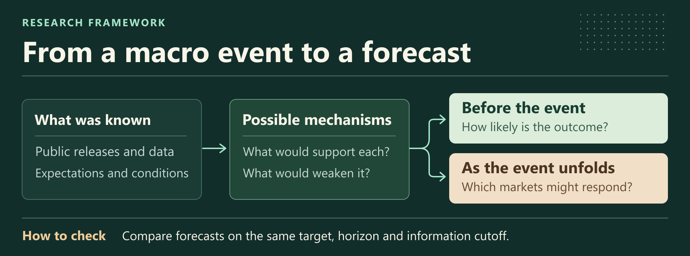
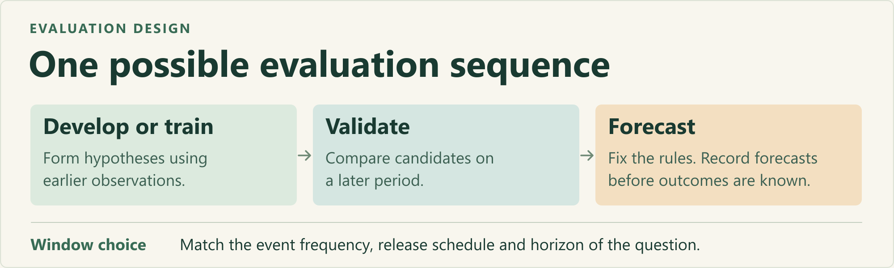

# Macro Events & Cross-Market Forecasting

**English** · [简体中文](README.zh-CN.md)

When oil prices rise, stronger demand and disrupted supply can both explain the headline. They can imply quite different things for an importing country's equities and bond yields. **At the moment the news breaks, what evidence could distinguish those explanations? What would change our view?**

Our aim is to connect what markets expected before a macro event, what a forecaster could know at the time, and what can be checked afterward. We study two questions: how likely an event is, and how its effects might travel across markets once it happens or while it unfolds.

[Research framework](#research-framework) · [Research agenda](#research-agenda) · [Evaluation design](#evaluation-design)

## Research framework

Consider a central bank meeting. Before the announcement, a researcher can estimate the probability of a policy change and record the probability on a matching prediction market, if one exists. Once the decision and its wording become public, a different question opens up. Where might the surprise show up first: in yields, exchange rates or equity indices? Each question has its own information cutoff, forecast horizon and outcome rule.

In this design, a research agent proposes hypotheses that could be disproved. Each one should identify the facts it relies on, the conditions under which it applies and the evidence that would weaken it. Several explanations may fit the same release. Sometimes the evidence warrants leaving the question open.

## Research agenda

**How much of the news was already expected?** We want to pair what markets anticipated with what was eventually announced. For events with a matching prediction market, we can compare probabilities on the same question, at the same cutoff and under the same settlement terms. Across many such forecasts, when does the agent pick up information the price has yet to reflect, and when does the market make the better call?

**Where does a shock travel, and how long does it last?** We aim to follow the same event across energy, rates, currencies, gold and equity indices in the US, Japan, South Korea and China. A supply disruption might move crude prices first, then import costs and inflation expectations. Weekly, monthly and event-specific observations would let us check which links appeared, in what order, and where the evidence runs out. An asset can be studied even when there is no corresponding prediction-market contract.

**Can an explanation survive the next event?** We want to translate official releases and analysts’ contemporaneous views into traceable hypotheses, preserving revisions, retractions and counterexamples. With the same information available to each method, we can test whether reasoning through a proposed mechanism adds anything to a direct forecast. Over time, we hope to build a cross-market case archive where a reader can recover what was known, inspect the competing explanations and see which one the outcome favored.

## Evaluation design

One possible design uses an earlier period to develop hypotheses or train a method, a later period to compare candidates, and fresh events to record forecasts under fixed rules. Window lengths depend on event frequency, publication timing and the forecast horizon. Once an outcome can be resolved under the original rule, the recorded forecast can be compared with a baseline chosen in advance.

The framework is under development. Our [research notes](docs/cases.en.md) document selected experiments, data-availability checks and rejected candidates. This project is for research and simulation only (`NO_ORDER`).
