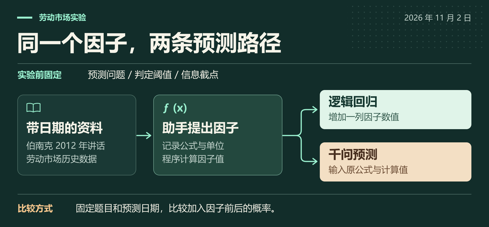
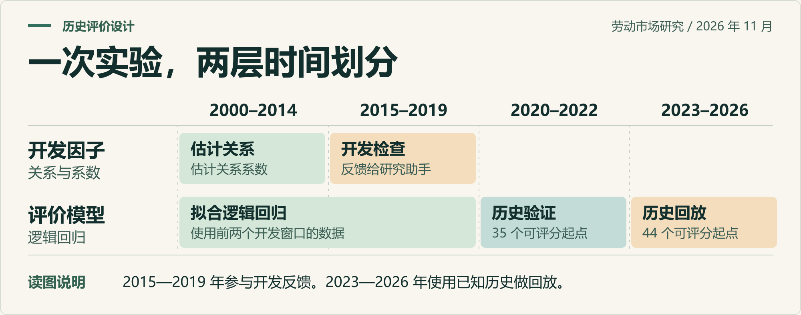

# 宏观事件与跨市场预测研究

[English](README.md) · **简体中文**

市场早已预期的加息，和出乎意料的加息，可以有完全相同的新闻标题。油价上涨，既可能来自需求走强，也可能源于供应中断。**只用预测当天能看到的信息，能否分清这些情形，判断哪些市场会受影响？**

我们希望建立一套覆盖利率、汇率、能源、黄金和股指的预测评测方法。每次预测都能回到三个具体问题：当时看到了哪份材料，判断依赖哪条经济机制，后来出现什么结果可以推翻这个判断。

[研究流程](#研究流程) · [已有证据](#已有证据) · [运行示例](#运行示例) · [研究展望](#研究展望)

## 研究流程



在 11 月 2 日的劳动市场实验中，助手读了伯南克 2012 年的一篇讲话和历史劳动市场数据，提出一个有条件的因子：当非农就业高于过去十二个季度的均值时，取劳动力人数的季度变化，否则取零。程序按公式算出数值。逻辑回归增加一列输入，千问在单独的预测对话里收到公式和计算值。

这两条路径的区别可以实查。实验里有一处单位说明写错，千问看到的是这个错误单位。逻辑回归用的是数值列，保存的 644 个概率都能从回归系数复算出来。千问当时给出的概率对应的是当时含错误单位的提示。

## 已有证据

| 研究问题 | 我们核对到了什么 |
| --- | --- |
| 模型预测能与盘口一一对应吗？ | 已核对 **30 个 Polymarket 市场**的原始规则，其中 **23 个**取得非空历史概率样例。比较某次预测时，还需要对齐题目、截点和结算规则。 |
| 劳动因子改善了预测吗？ | 对“美国失业率本月是否上升”这个问题，加入因子后，验证段 Brier 分数从 **0.2398 降至 0.2351**，历史回放段从 **0.1950 升至 0.2029**。这个分数越低越好。 |
| 能识别看起来合理的数据泄漏吗？ | 在独立的 11 月 4 日实验中，Qwen3-8B 收到 **275 个月**的真实观测，提出的公式却依赖待预测季度的失业率。程序在拟合前拦下了它。[查看案例](docs/cases.md) |
| 哪些题已经能核对真实结局？ | 截至 2026 年 11 月 7 日，冻结的 **6 道前瞻题中有 3 道**核实了结果，整组仍待评分。 |



两个分数分别基于 35 个验证起点和 44 个历史回放起点。两段都属于历史实验。早期窗口缺值和部分数据的可用时间仍需核实，预测未来是否有优势还要用新的前瞻样本来回答。

## 运行示例

站在 2023 年 1 月 15 日，能用哪一期美国失业率？在仓库根目录用 Python 3.11 运行下面的示例，只需标准库，可以离线运行。

```shell
python examples/release_cutoff.py
```

```text
2022-12  3.5%  BEFORE_CUTOFF
2023-01  3.4%  AFTER_CUTOFF
```

参考月说明数字描述的是哪个月，发布日期决定它何时能进入预测。[案例说明和 ALFRED 来源](docs/cases.md)

## 研究展望

| 方向 | 我们希望回答的问题 |
| --- | --- |
| **事件公布前** | 对央行决议和宏观数据发布，助手给出的概率能否比历史基线或同题盘口更贴近实际频率？我们希望在答案揭晓前固定预测和对照价格，再按原题结算。 |
| **事件发生后与持续过程中** | 政策或供应条件改变时，哪些资产会响应，方向如何，能持续多久？我们计划按周、月和具体事件窗口，追踪同一事件在不同市场的表现，包括没有对应盘口的资产。 |
| **检验竞争机制** | 把官方原文和有日期的分析观点转成可检验的判断。在各模型看到相同资料时，一条机制能否比简单基线多解释一点、预测好一点？观点后来的修订及反证也应留在记录中。 |

当前公开内容包括案例、流程图和可运行示例。更广的历史版本数据集和跨市场前瞻比较仍是研究目标。本项目仅用于研究与模拟（`NO_ORDER`）。
